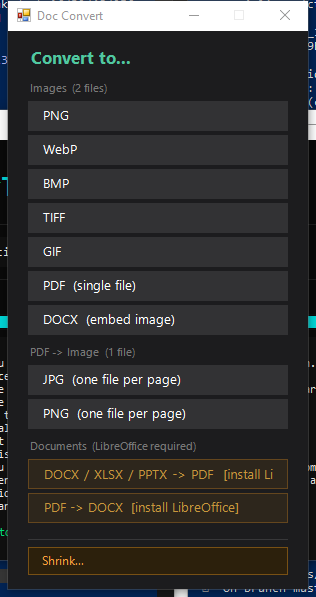
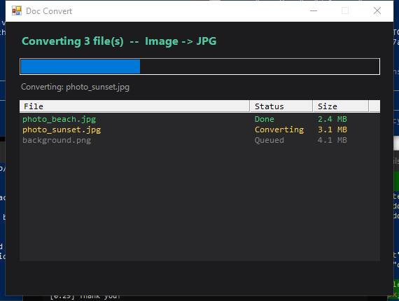
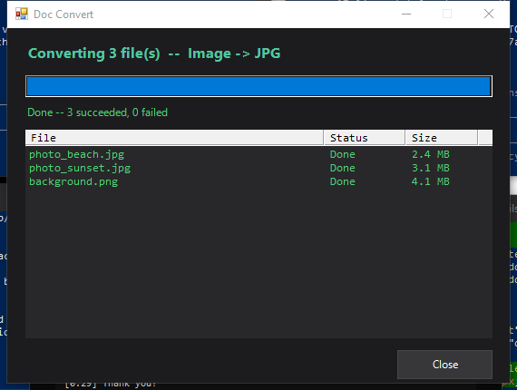

# Doc Convert Menu

Windows right-click context menu for file format conversion. Select any image, PDF, or document in Explorer → **Convert with Doc Convert** → pick a format. No admin rights, no dedicated app to open.

> **Platform:** Windows only. The conversion engine is PowerShell-native and relies on Windows shell integration. A Python-based cross-platform port (macOS + Linux) is planned.

**[Project page →](https://webdev.dvlce.ca/doc-convert)**

## Screenshots

Pick a target format — only formats supported by your installed tools are shown:



Progress while converting:



All done:



## Install

### One-click installer (recommended)

Download **[DocConvertSetup.exe](https://github.com/toyuvalo/doc-convert-menu/releases/latest)** and run it.

The installer (Inno Setup, per-user, no admin):
- Copies `DocConvert.exe` and `doc-convert.ps1` to `%LOCALAPPDATA%\DocConvertMenu\`
- Registers all file type context menu entries in HKCU
- Adds a normal uninstall entry in Settings > Apps
- Runs no scripts and downloads nothing. `python-docx` and `PyMuPDF` are pip-installed on first use, if Python is present

### Manual install

```powershell
git clone https://github.com/toyuvalo/doc-convert-menu
cd doc-convert-menu
powershell -ExecutionPolicy Bypass -File install.ps1
```

## Supported conversions

| Input | Output | Requires |
|-------|--------|----------|
| JPG / PNG / WebP / BMP / TIFF / GIF / HEIC / AVIF / JP2 | Any image format | ImageMagick |
| Any image | PDF | ImageMagick |
| PDF | JPG / PNG (one file per page) | PyMuPDF (auto-installed) |
| Any image | DOCX (embedded) | python-docx (auto-installed) |
| DOCX / XLSX / PPTX / ODT | PDF | LibreOffice (optional) |
| PDF | DOCX | LibreOffice (optional) |

## Requirements

- Windows 10/11
- [ImageMagick 7+](https://imagemagick.org/script/download.php#windows) — for image and PDF↔image conversions. Since v1.3.2 the installer downloads it when it is not on your PATH: the newest portable build from [GitHub](https://github.com/ImageMagick/ImageMagick/releases), SHA-256 checked, into `%LOCALAPPDATA%\Programs\DVLCE\imagemagick`, added to your user PATH. Shrink Menu uses the same copy; uninstalling removes it only when no other tool still needs it
- Python 3.8+ — optional, needed for DOCX embedding and PDF→image
- LibreOffice — optional, needed for DOCX/XLSX/PPTX→PDF

## Features

- **No admin rights** — all registry entries written to HKCU
- **Multi-file selection** — select any number of files, right-click once, convert all of them
- **Auto dependency install** — `python-docx` and `PyMuPDF` pip-installed automatically on first use
- **Multi-select via Shell COM** — the compiled `DocConvert.exe` launcher collects every selected file from the right Explorer window
- **Any file name** — smart quotes (`’`), accents, `[brackets]` and `%` all convert correctly. Earlier versions silently skipped them: the Explorer file list was handed over in the system codepage and read back as UTF-8, so those names stopped resolving. Fixed in v1.2.1

## Build the installer

Requires Windows, the in-box .NET Framework 4.x compiler, and [Inno Setup 6](https://jrsoftware.org/isinfo.php) (`winget install JRSoftware.InnoSetup`):

```cmd
build.cmd
```

Produces `build\DocConvert.exe` and `DocConvertSetup.exe` in the repo root.

### Antivirus alerts

Up to v1.2.1 the installer was an IExpress package that ran `powershell -ExecutionPolicy Bypass`, and the menu ran `wscript.exe launcher.vbs`, which started a hidden PowerShell window. That chain matches common malware, so some antivirus products flagged it as a trojan. v1.3.0 removes IExpress and VBScript. From v1.3.1 the installer, the launcher and the script are code-signed (publisher "Yuval Olsha", Microsoft Azure Artifact Signing).

## Uninstall

Settings > Apps > **Doc Convert Menu** > Uninstall. For a manual install:

```powershell
powershell -ExecutionPolicy Bypass -File "%LOCALAPPDATA%\DocConvertMenu\uninstall.ps1"
```

## Related

- [ffmpeg-context-menu](https://github.com/toyuvalo/ffmpeg-context-menu) — same idea for audio/video conversion with FFmpeg
- [webdev.dvlce.ca/doc-convert](https://webdev.dvlce.ca/doc-convert) — project page

## License

MIT with [Commons Clause](https://commonsclause.com/) — free to use, modify, and share. Commercial resale not permitted.
